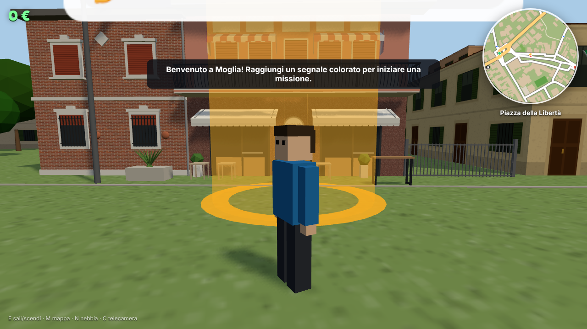
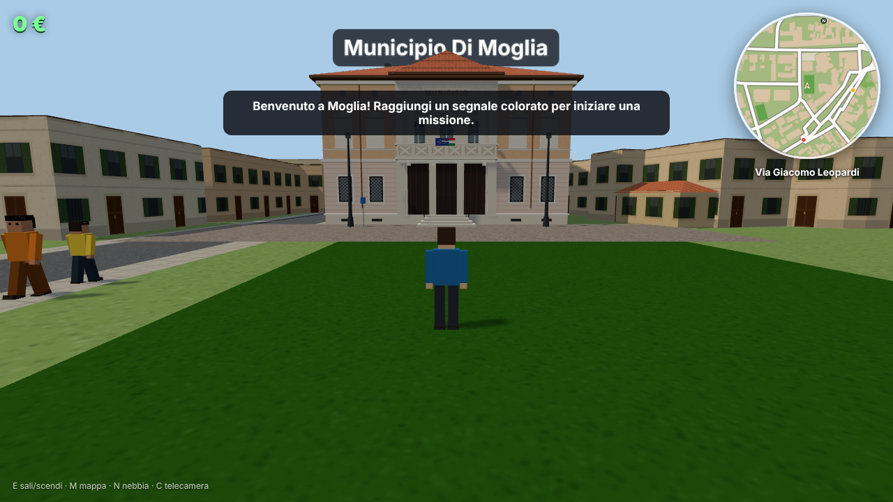
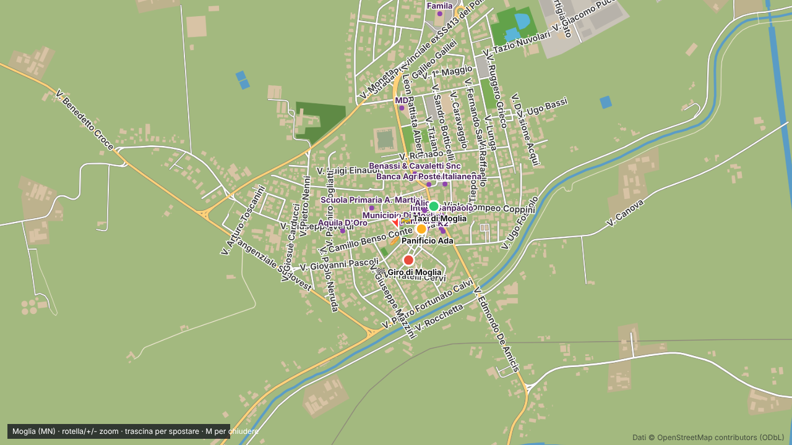

# Moglia City

Un mini open world 3D in terza persona, nel browser, ambientato nelle vie vere di **Moglia (MN)**. Si gira a piedi o in auto tra strade ed edifici ricostruiti dai dati OpenStreetMap, con traffico, pedoni e qualche missione a tempo.



## Cosa c'è

- **Mappa reale**: 302 tratti di strada con nome e sensi unici, 1.920 edifici con la sagoma vera, canali, parchi, piazze e luoghi con nome, tutto da OpenStreetMap.
- **Edifici ricostruiti a mano**: il Panificio Ada (con la casa in mattoni accanto) e il Municipio, modellati da foto.
- **Gameplay**: si cammina, si corre e si salta. Si sale su qualunque veicolo: utilitarie, berline, furgoni, motocarri, trattori e auto della Polizia Locale.
- **Vita in paese**: traffico che segue il grafo stradale e pedoni sui marciapiedi, che si scansano e brontolano in dialetto.
- **Missioni**: consegne del pane (Panificio Ada), taxi (Piazza Marconi), Giro di Moglia a tappe (Piazza della Libertà).
- **Interfaccia**: minimappa con il nome della via, mappa completa del paese con i nomi delle strade, nebbia della Bassa, controlli touch per telefono.

| Municipio | Mappa del paese |
|---|---|
|  |  |

## Comandi

| Tasto | Azione |
|---|---|
| `W A S D` / frecce | cammina · guida |
| Mouse | guarda intorno (clic per bloccare il cursore) |
| `Shift` | corri |
| `Spazio` | salta · freno a mano |
| `E` | sali / scendi da un veicolo |
| `H` | clacson |
| `R` | rimetti l'auto in strada |
| `M` | mappa del paese (rotella per lo zoom, trascina per spostarti) |
| `C` | cambia distanza della telecamera |
| `N` | nebbia |
| `U` | audio on/off |

## Sviluppo

Servono Node.js 20 o successivo e, solo per rigenerare i dati della mappa, Python 3.

```bash
npm install
npm run dev      # http://localhost:8000, ricostruisce a ogni modifica
npm run build    # crea dist/index.html, un unico file autosufficiente
npm test         # test di fumo nel browser (la prima volta: npx playwright install chromium)
```

`dist/index.html` contiene il gioco, Three.js e la mappa: si può aprire con un doppio clic o caricare su qualunque hosting statico.

### Aggiornare o allargare la mappa

```bash
npm run fetch-osm                                   # scarica data/moglia.osm dal riquadro predefinito
BBOX=10.880,44.915,10.945,44.952 npm run fetch-osm  # riquadro più ampio (ovest,sud,est,nord)
npm run data                                        # converte in data/moglia.json
```

Il convertitore usa un seme casuale fisso, quindi a parità di dati OSM produce sempre lo stesso file.

## Struttura

```
src/
  main.js               ciclo di gioco, input, giocatore, traffico, pedoni, missioni, HUD, minimappa
  world.js              costruzione della città: terreno, strade, edifici, alberi, collisioni, grafo stradale
  landmarks.js          edifici modellati a mano (Panificio Ada, Municipio)
  entities.js           modelli low-poly di veicoli e persone
  util.js               geometria, texture procedurali, griglia spaziale
  index.template.html   pagina, HUD e stili
data/moglia.json        mappa in formato compatto (generata da tools/osm2json.py)
tools/                  download e conversione dei dati OpenStreetMap
tests/smoke.mjs         test automatico nel browser
build.mjs               build e server di sviluppo (esbuild)
```

### Aggiungere un edificio riconoscibile

1. In `src/landmarks.js` scrivi una coppia `prepareX(D)` / `buildX(D, W, scene, prep)`, sul modello di `prepareMunicipio` / `buildMunicipio`.
2. `prepareX` trova l'edificio nei dati (per nome o per vicinanza a un punto) e lo marca `hidden: true`: la geometria generica non viene disegnata, ma la sagoma resta per le collisioni.
3. `buildX` costruisce il modello in un sistema locale allineato alla facciata: X lungo la facciata, Z verso la strada.
4. Richiama le due funzioni in `src/main.js`, accanto alle altre.

## Pubblicazione su GitHub Pages

Il workflow `.github/workflows/pages.yml`, a ogni push su `main`, compila il gioco, esegue il test e pubblica `dist/` su GitHub Pages. Per attivarlo: **Settings → Pages → Source: GitHub Actions**.

## Licenze

- **Codice**: MIT, vedi [LICENSE](LICENSE).
- **Dati cartografici** (`data/`): © OpenStreetMap contributors, disponibili con licenza [Open Database License (ODbL)](https://opendatacommons.org/licenses/odbl/). `data/moglia.json` è un database derivato e resta sotto ODbL. Chi lo modifica e lo ridistribuisce deve mantenere l'attribuzione e la stessa licenza.
- Le altezze degli edifici, quando OSM non le riporta, e le facciate generiche sono stime generate dal codice e non descrivono gli edifici reali.
- [Three.js](https://threejs.org) è distribuito con licenza MIT.
